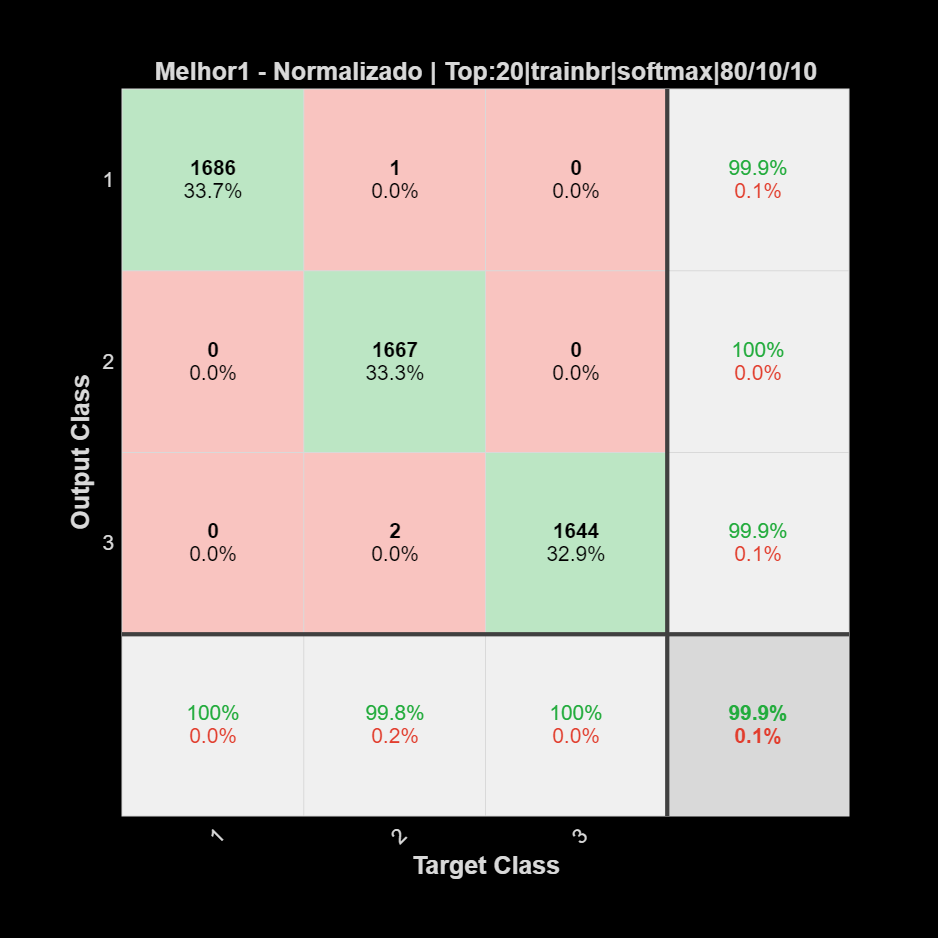

# Diagnóstico de Falhas em Motores Industriais com CBR e Redes Neuronais

Projeto desenvolvido em **MATLAB** no âmbito da unidade curricular de **Conhecimento e Raciocínio** (Licenciatura em Engenharia Informática, ISEC, 2025/2026).

O objetivo é diagnosticar o estado de um motor industrial (**funcionamento normal**, **falha elétrica** ou **falha mecânica**) a partir de 14 medições e características do equipamento, como temperatura, vibração, tensão, corrente, binário e nível de manutenção. O problema é resolvido com duas abordagens, cujos resultados são comparados no fim:

1. **Raciocínio baseado em casos (CBR)**, implementado de raiz, sem bibliotecas de CBR
2. **Redes neuronais feedforward**, com a Deep Learning Toolbox do MATLAB

## Estrutura

```
├── main.m                  Executa as três tarefas por ordem
├── tarefa3_1.m             Tratamento do dataset
├── tarefa3_2_cbr.m         Sistema CBR e respetivos testes
├── tarefa3_3_rn_TESTE.m    Estudo e teste das redes neuronais
├── modelos/                As três melhores redes treinadas (.mat)
└── resultados/             Matrizes de confusão das melhores e piores configurações
```

## 1. Tratamento do dataset (`tarefa3_1.m`)

O dataset tem 5000 registos, com valores em falta nos atributos de entrada e na própria classe.

- **Atributos categóricos:** os ordinais foram codificados respeitando a ordem (`maintenance_level`: Low < Medium < High; `operating_mode`: Idle < Normal < Overload) e os binários sem ordem foram codificados como 0/1 (`cooling_type`, `sensor_status`).
- **Valores em falta nos atributos numéricos:** usou-se a média nos atributos sem outliers e a mediana nos atributos com outliers (por exemplo, `voltage`, com 6,6% de outliers). Nos categóricos usou-se a moda.
- **Valores em falta na classe:** foram preenchidos com a fase *Retrieve* do CBR, copiando a classe do registo conhecido mais semelhante. A semelhança é uma média ponderada, com pesos maiores para os atributos mais ligados a falhas (vibração, corrente, tensão, binário).
- No fim é gerada uma versão normalizada (min-max) dos atributos, usada para comparar resultados com e sem normalização.

## 2. Sistema CBR (`tarefa3_2_cbr.m`)

Sistema interativo que implementa o ciclo completo do CBR:

| Fase | O que faz |
|---|---|
| **Retrieve** | Calcula as similaridades locais e a similaridade global ponderada entre um novo caso e a base de casos, e mostra os casos acima de um limiar (0,75) |
| **Reuse** | Uma rede neuronal treinada com `vibration`, `rotation_speed` e `voltage` propõe um valor ajustado de `temperature` |
| **Revise** | O utilizador decide se aceita o valor proposto pela rede |
| **Retain** | O utilizador decide se o novo caso é acrescentado à base de casos |

O sistema foi testado com um conjunto de casos de teste independente, comparando três configurações de pesos (pesos definidos pelo domínio, pesos iguais e foco nos atributos elétricos) com dados normalizados e não normalizados.

## 3. Redes neuronais (`tarefa3_3_rn_TESTE.m`)

Estudo de redes feedforward para a classificação das três classes, variando:

- **Topologia:** 10 e 20 neurónios numa camada; [10 10] e [20 20] em duas camadas
- **Função de treino:** `trainlm`, `trainbr`, `traingd` (com três taxas de aprendizagem) e `trainscg`
- **Função de ativação na saída:** `logsig`, `softmax`, `tansig` e `purelin`
- **Divisão treino/validação/teste:** 70/15/15 e 80/10/10

No total foram avaliadas 192 configurações, cada uma repetida 10 vezes com dados normalizados e não normalizados (3840 treinos), registando a média das taxas de acerto global e de teste. As três melhores redes foram gravadas e testadas no conjunto de teste independente.

### Resultados

- A melhor configuração (20 neurónios, `trainbr`, `softmax`, divisão 80/10/10, dados normalizados) acertou **99,9%** dos 5000 registos.
- A pior configuração ([10 10], `traingd` com taxa de aprendizagem 0,01, `logsig`) ficou nos **58,3%** e quase não reconheceu as falhas mecânicas.
- As três melhores redes classificaram corretamente os **30 casos** do conjunto de teste independente.

| Melhor configuração | Pior configuração |
|---|---|
|  |  |

As restantes matrizes de confusão estão na pasta [`resultados/`](resultados/).

## Como executar

Requisitos: **MATLAB** com a **Deep Learning Toolbox**.

1. Coloque na pasta do projeto os ficheiros `dataset_TP.csv` e `dataset_TP_test.csv`. Os datasets foram fornecidos pelos docentes da unidade curricular e não estão incluídos neste repositório.
2. No MATLAB, abra a pasta do projeto e execute:

   ```matlab
   main
   ```

   Também é possível executar cada tarefa em separado, começando pela `tarefa3_1.m`, que gera o `dataset_tratado.mat` usado pelas seguintes.

O sistema CBR é interativo: pede os valores de um novo caso e as decisões das fases *Revise* e *Retain*. O estudo completo das redes neuronais demora bastante tempo, por ser composto por 3840 treinos.

## Autores

- Pedro Pinto — [@pedro-cpinto](https://github.com/pedro-cpinto)
- [Nome do colega] — [@utilizador-do-colega](https://github.com/utilizador-do-colega)

Projeto académico desenvolvido em par.
